# AVA R-Type

[](https://github.com/Harlock123/AVARType/actions/workflows/build.yml)

A side-scrolling shooter in the style of Irem's 1987 arcade game **R-Type**, built with .NET 10 and Avalonia
UI. The Swarm, a living empire of bone and metal, is spreading through the stars. Fly the fighter **Lancet**
into its domain with the indestructible **orb** and the charged beam, and strike at its heart.

## Features

- **The orb:** shoot down a porter for a crystal, and the first one brings the orb, which fixes itself to the
  Lancet's nose.
  - It soaks up enemy shots and chews through whatever it touches.
  - Press the orb button and it flies off on its own to the far side of the screen, firing as it goes, while
    you fly free. Press again and it comes back, fixing itself to whichever side of the ship it meets: nose or
    tail.
  - More crystals make the orb stronger, and each crystal's colour decides its laser: **red** fires a
    spiralling beam that goes through everything in a line; **blue** fires lasers that bounce off the walls;
    **yellow** fires lasers that run along the floor and the roof.
- **The beam:** tap fire for a stream of shots; hold it and the beam meter fills. Let go to loose a beam that
  goes through one thing into the next. The longer the charge, the bigger and stronger the beam.
- **More from the porters:** speed-ups, **bits** (two little orbs that ride above and below the ship, fire
  with it and soak up shots) and homing missiles.
- **Four stages**, each with a boss at its end:
  - **The Outer Wall:** bone-and-metal structures, striders and guns, and armour to shoot through. At the end
    is **the Hollow Mother**: her core is in her belly, her swinging tail is deadly, and she spits embryos.
    Her shots fan out either side of her core's line.
  - **The Spawning Caves:** living tissue that grows back after it's shot, pods spitting, and **the Serpent**,
    which coils round its lair. Only its head can be hurt, and its body stops shots.
  - **The Dreadnought:** along the hull of a warship of the Swarm, batteries that take a lot of shots, and
    **its engines**, three of them, jetting flame.
  - **The Heart:** living walls closing in, and **the Overmind**, which can only be hurt while its shell is
    open.
- **Like the original, it's hard:** a lost ship starts again at the last checkpoint without the orb or
  anything else. A boss not beaten in time withdraws, and the stage ends without its points. After the
  Overmind, the Swarm comes round again, faster.
- **The ship's computer speaks:** "Lancet, go!", "Warning!" when a boss arrives, and "Well done!" at the end of
  each stage. The voice comes from a small formant synthesiser in the build tools.
- **Original music:** a brooding stage tune in C minor, a boss theme, a title theme and jingles.
- **The attract mode** shows the computer pilot at work. Every few steps it tries each way to steer on copies
  of the world and takes the one that keeps the ship alive, lined up and near what the porters drop. It taps
  fire for a stream of shots, and against a boss charges the beam and lets it go.

## Screenshots

| The title | A porter | The orb, red |
|:---------:|:--------:|:------------:|
| 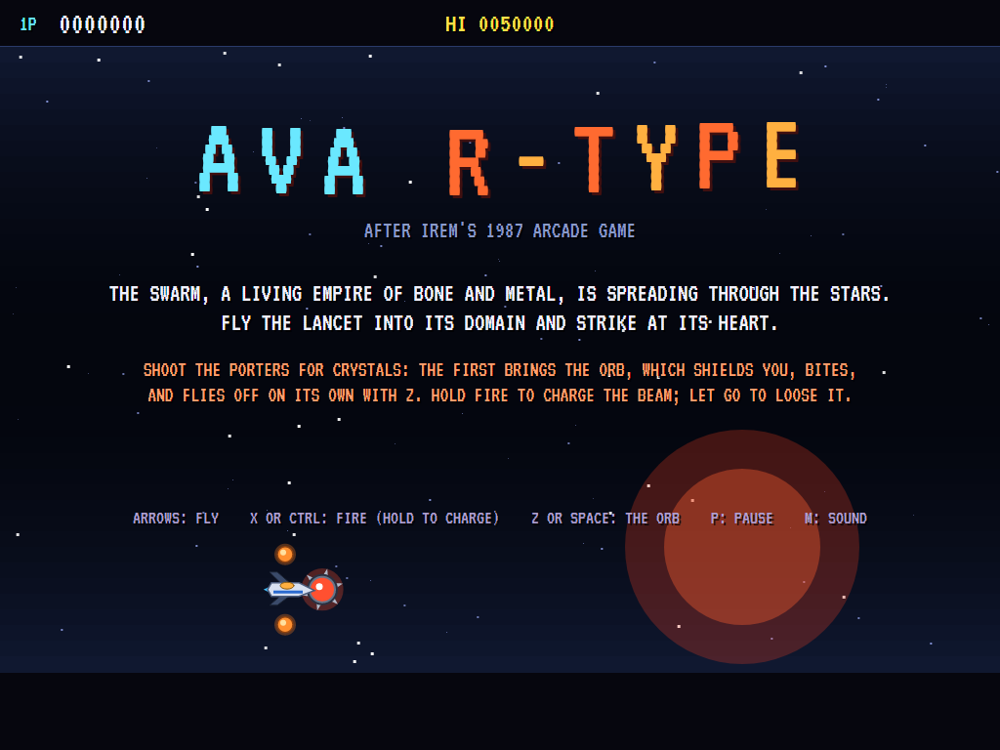 | 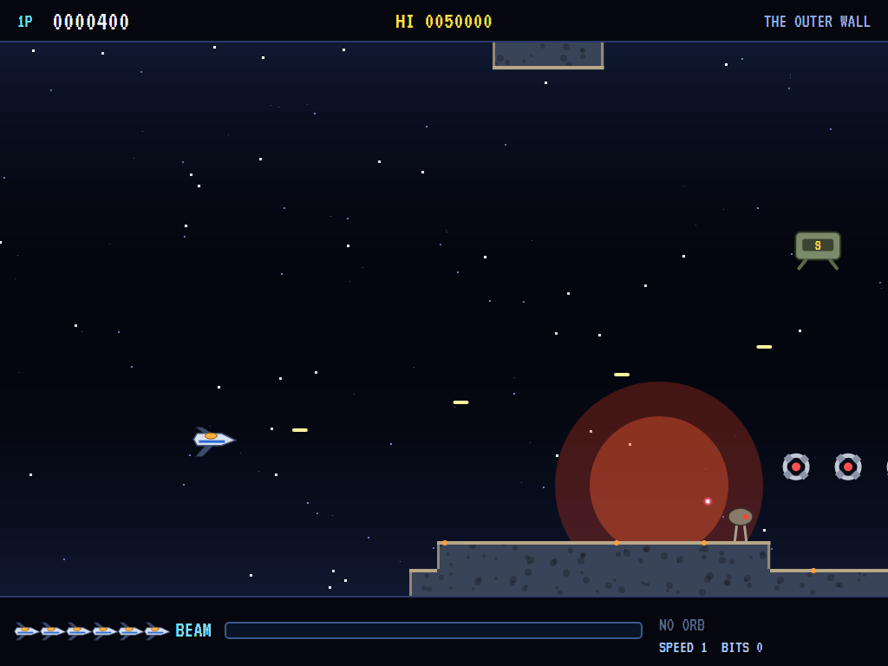 | 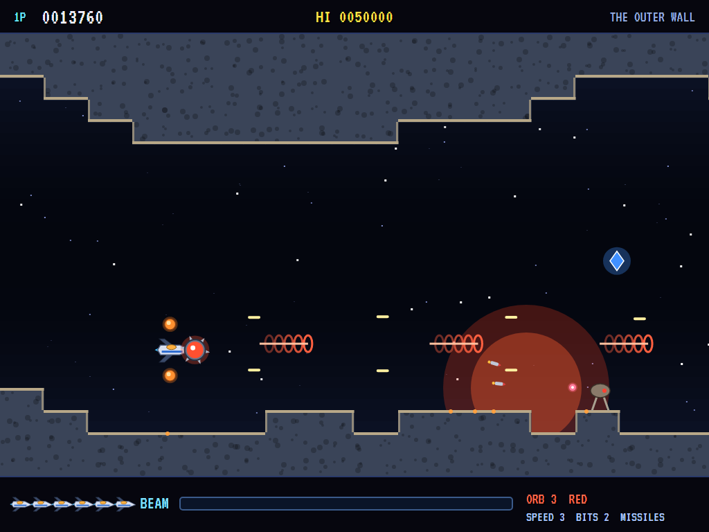 |
| The Lancet, orb and bits. | Shoot it for what it carries. | The red laser, and a crystal. |

| The beam | The Hollow Mother | The orb on its own |
|:--------:|:-----------------:|:------------------:|
| 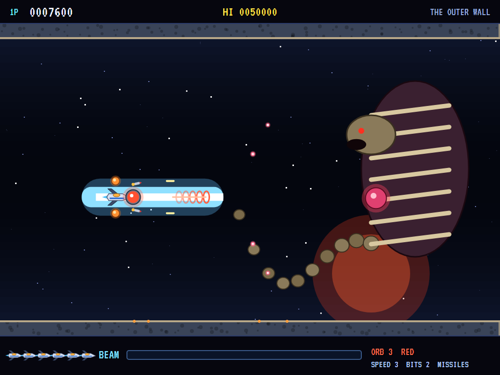 | 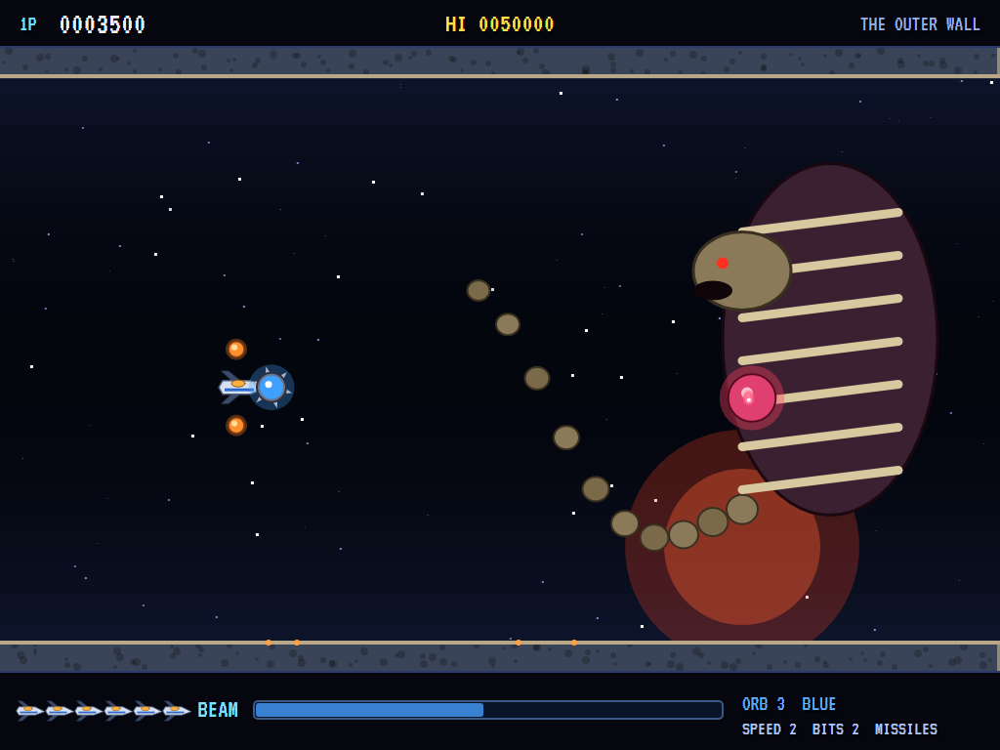 | 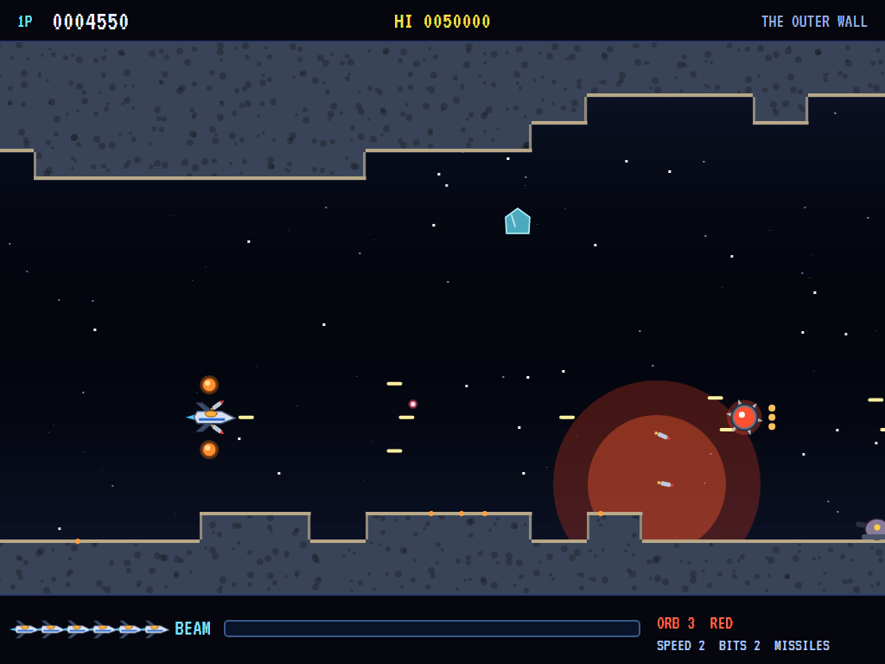 |
| Fully charged. | Her core, her tail. | Launched ahead. |

| The caves | The Serpent | The dreadnought |
|:---------:|:-----------:|:---------------:|
| 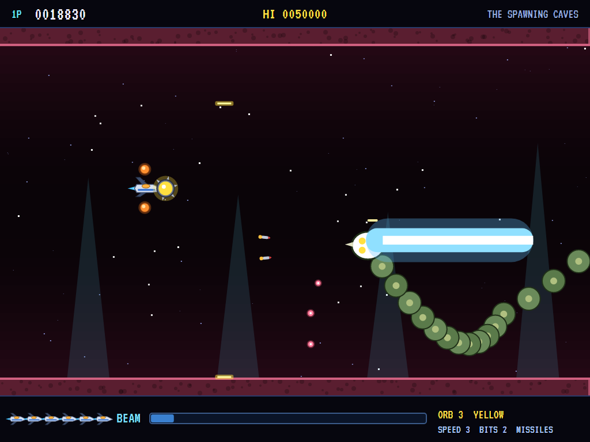 | 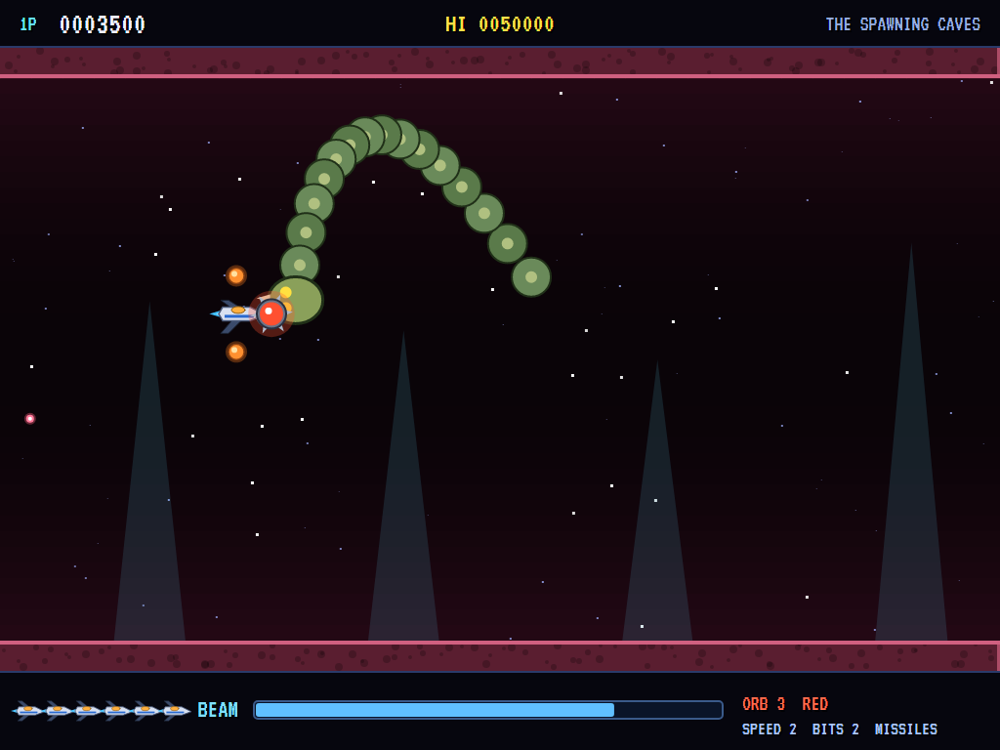 | 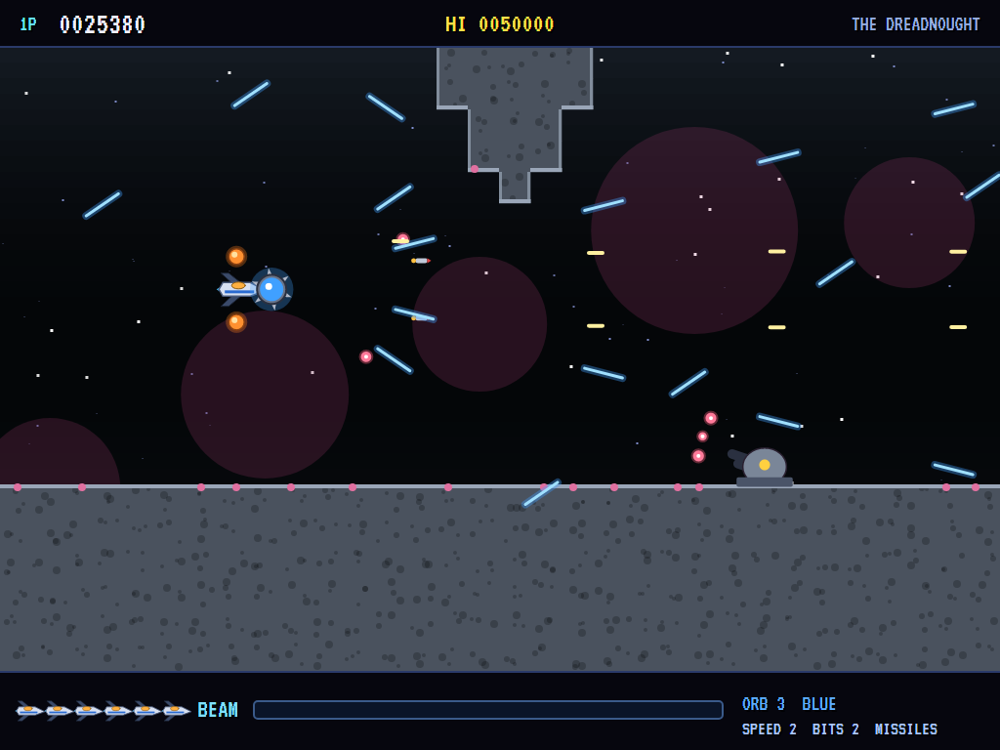 |
| The yellow laser. | Coiling round its lair. | The blue laser, batteries. |

| The engines | The Overmind | The ace pilots |
|:-----------:|:------------:|:--------------:|
| 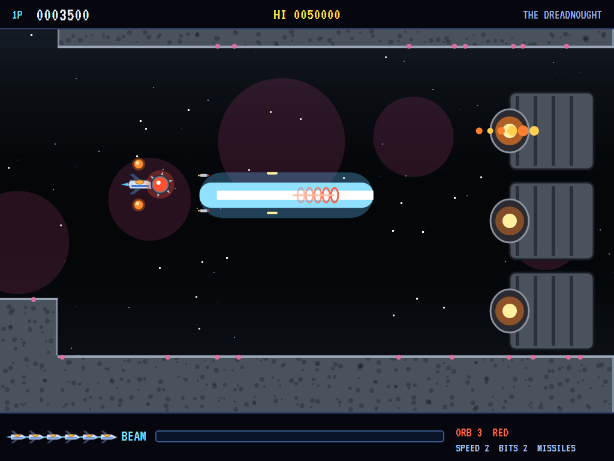 | 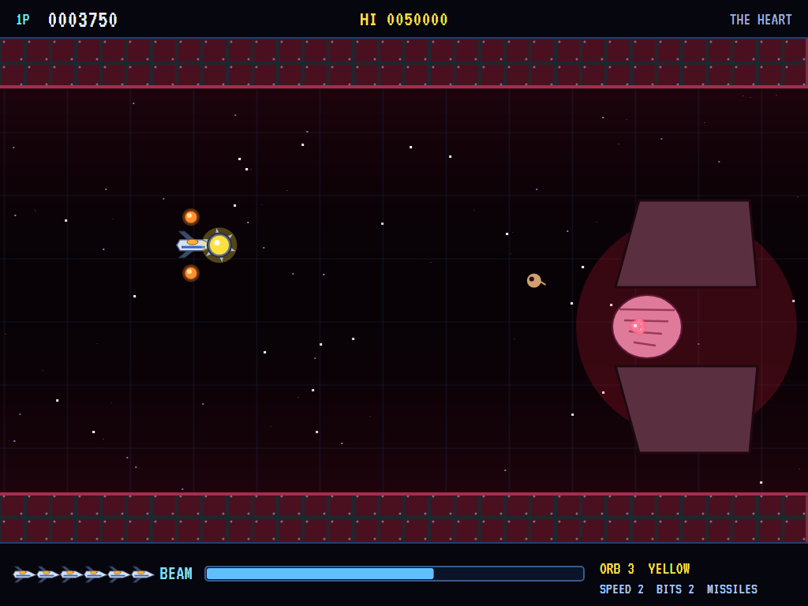 | 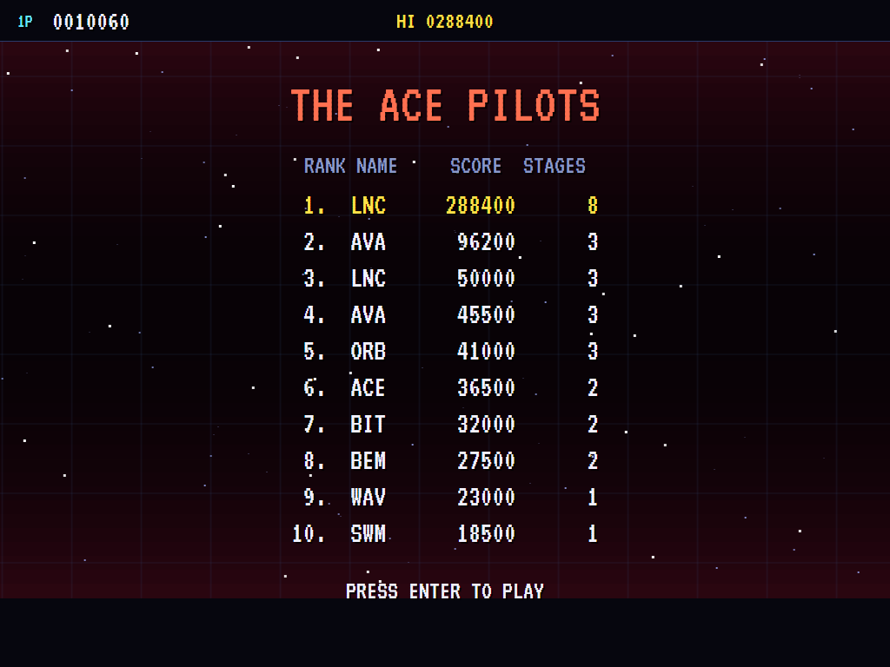 |
| Three of them, jetting flame. | Its shell open. | The high-score table. |

The screenshots are made by the tests, which play the game in a real (headless) window; see
[Tests](#tests).

## Download and run

Ready-to-run builds for Windows, macOS and Linux, on both Intel/AMD and ARM, are on the
[Releases page](https://github.com/Harlock123/AVARType/releases/tag/latest). **Latest build** is
rebuilt on every push to `main`. Each download is one self-contained executable: no .NET install is
needed.

| Platform | Archive |
|---|---|
| Windows | `AVARType-win-x64.zip`, `AVARType-win-x86.zip`, `AVARType-win-arm64.zip` |
| macOS | `AVARType-osx-arm64.tar.gz` (Apple silicon), `AVARType-osx-x64.tar.gz` (Intel) |
| Linux | `AVARType-linux-x64.tar.gz`, `AVARType-linux-arm64.tar.gz`, `AVARType-linux-arm.tar.gz` |

```bash
tar -xzf AVARType-linux-x64.tar.gz     # or linux-arm64, linux-arm, osx-arm64, osx-x64
./AVARType
```

On Windows, unzip and run `AVARType.exe`. On macOS, if Gatekeeper refuses to open it, run
`xattr -d com.apple.quarantine AVARType` once. Run with `--no-audio` for silence.

**Sound** comes through OpenAL Soft, built in for every platform. In a virtual machine the game
detects it and uses a larger audio buffer, so the sound doesn't break up.

**Gamepads** use SDL2, which is bundled for Windows, macOS and Intel/AMD Linux. ARM Linux builds need it
installed; without it the keyboard still works:

```bash
sudo apt install libsdl2-dev            # Debian / Ubuntu / Raspberry Pi OS
sudo pacman -S --needed sdl2-compat     # Arch / Omarchy
```

## Controls

| Action | Keyboard | Gamepad |
|---|---|---|
| Start | Enter or 1 | Start |
| Fly | Arrows or W/A/S/D | Left stick / D-pad |
| Fire (tap), charge the beam (hold), loose it (let go) | X, Ctrl or Shift | B, X or right trigger |
| The orb: launch it, call it back | Z or Space | A |
| Pause | P or Esc | Start or Back |
| Sound on/off | M | |
| Screenshot | Ctrl+S (to your Pictures folder) | |

On the high-score table, type your initials, or use up/down and Space, then Enter.

## Tests

```bash
dotnet test AVARType.slnx
```

The game runs in fixed 60 Hz steps, so it plays the same at any frame rate. Everything that moves lives in
one world that can be copied, and a copy plays out exactly as the world does (that's tested too). The tests
check:

- **The stages:** there's always a way through that never jumps, the checkpoints are clear, the arenas are
  open, every stage has porters with crystals, and the computer pilot clears each one.
- **Flying and shooting:** the stage carries the ship and walls are deadly; a tap shoots, a held button
  charges the beam, and letting go looses it through one thing into the next; a short charge is a weak beam.
- **The orb and the porters:** a porter drops what it carries, and the first crystal brings the orb, with
  more crystals making it stronger in the new colour; the orb soaks up shots and chews up what it touches;
  it launches, hangs off on its own, and comes back to whichever side it meets; each colour fires its own
  laser; speed, bits and missiles; losing the ship loses the orb.
- **The Swarm and the bosses:** guns fire at the ship; batteries take a lot of shots; tissue grows back; the
  Mother is hurt only in her core; the Serpent's body stops shots and its head can be hurt; the engines are
  three and all must go; the Overmind is hurt only with its shell open; a boss not beaten in time withdraws.
- **The game:** a lost ship starts again at the checkpoint with nothing; a cleared stage goes on with the orb
  and the rest; the last ship and the high-score table; the computer pilot flies the whole game round to the
  start again; the demonstration and the high scores; the keys.

`tests/AVARType.Tests/PilotProbe.cs` reports how the computer pilot gets on in each stage, for tuning
(`RTYPE_PROBE=1`; `RTYPE_PROBE=lazy` for a pilot who only holds the middle and fires).

The screenshot tests draw the real screen in a headless window. To refresh the README's pictures:

```bash
RTYPE_SHOTS=$PWD/Images dotnet test tests/AVARType.Tests --filter ScreenshotTests
```

## Building

```bash
dotnet build AVARType.slnx
dotnet run --project src/AVARType
```

Needs the .NET 10 SDK. The sounds, the voice and the tunes are made by `tools/make_sounds.py`
(standard-library Python, with `tools/speech.py` for the voice): `python3 tools/make_sounds.py` rewrites
`src/AVARType/Sounds`.

## Project structure

```
AVARType/
├── AVARType.slnx
├── src/AVARType/
│   ├── Engine/
│   │   ├── GameEngine.cs        # States, lives, checkpoints, stages in turn, the title and demonstration
│   │   ├── Sim.cs               # A stage step by step: the ship, the orb, lasers and the beam, the Swarm, the bosses, hits
│   │   ├── World.cs             # Everything that moves, kept together so it can be copied
│   │   ├── Stage.cs             # Squares, how a stage is built, and the four stages
│   │   ├── Pilot.cs             # The computer pilot (the demonstration, and the tests)
│   │   ├── HighScoreTable.cs, InitialsEntry.cs
│   │   ├── InputHandler.cs, ControllerManager.cs  # Keys and an SDL2 gamepad
│   │   └── SoundManager.cs      # Effects, the voice and the music through OpenAL
│   ├── Audio/                   # The OpenAL engine (from the author's AVABand)
│   ├── Views/                   # The drawing: the stages, the Lancet and its orb, the Swarm and its bosses
│   └── Sounds/                  # The synthesised effects, voice and tunes
├── tests/AVARType.Tests/        # Stage, gameplay and screenshot tests
├── tools/make_sounds.py, tools/speech.py
└── Images/                      # Screenshots
```

## About and licence

AVA R-Type © 2026 Lonnie Watson, under the [MIT License](LICENSE).

*R-Type* © 1987 Irem; the name belongs to its current owner. AVA R-Type is an independent, unofficial game in
its style. Its ship, orb, enemies, stages and bosses, its graphics, sounds, voice, tunes and code are its own;
nothing is taken from the original game's program, graphics or sound. It is not affiliated with or endorsed
by any rights holder.
